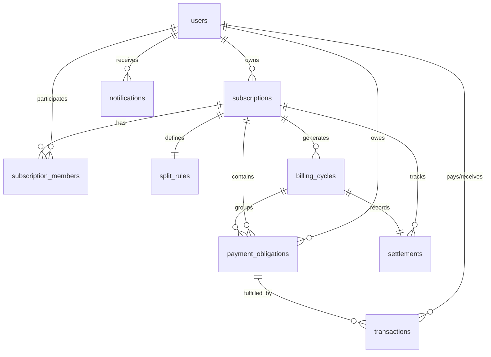

# SplitSub – Smart Shared Subscription Manager & UPI Allocation Platform

> **SplitSub** is a modern, full-stack collaborative subscription management platform tailored for Indian friend circles, roommates, and families. It automates intelligent cost allocation with exact Indian Rupee & paise precision, streamlines recurring UPI-based payments via dynamic QR codes and deep links, provides transparent settlement tracking, and delivers automated payment reminders.

---

## 🚀 Key Highlights & Fintech Features

1. **Intelligent Cost Splitting Engine (Exact Rupee Precision)**
   - **Equal Split**: Integer paise allocation with largest remainder distribution (e.g. ₹599 / 5 = ₹119.80 each; ₹100 / 3 = ₹33.34, ₹33.33, ₹33.33 => Total ₹100.00 exactly).
   - **Percentage Split**: Custom percentage shares with residual paise balancing (validates total equals 100%).
   - **Custom Split**: Exact rupee assignment with total price invariant check.
   - **Usage-Based Split**: Configurable screen/quota weights (e.g., 2 screens for Member A, 1 screen for Member B).

2. **Realistic UPI Payment Flow & Dynamic QR Generation**
   - Direct NPCI compliant UPI Intent URI generation (`upi://pay?pa=...&pn=...&am=...&cu=INR&tn=...&tr=...`).
   - Dynamic high-resolution QR codes generated on the fly for any UPI application (Google Pay, PhonePe, Paytm, BHIM, CRED, Amazon Pay).
   - Single-click UPI ID copying and mobile deep-link triggers.
   - **Realistic Sandbox / Demo Payment Simulator**: Clearly badged demo gateway allowing immediate testing of "Simulate Payment Success" (with confetti & settlement updates) and "Simulate Payment Failure".
   - Webhook-ready architecture for production gateway drop-in (Razorpay, Cashfree, Setu).

3. **Settlement Engine (Fronting & Debts)**
   - When an owner pays the full subscription upfront (e.g. ₹599 to Netflix), SplitSub tracks:
     - Total paid by owner (₹599.00)
     - Total collected from members (₹479.20)
     - Remaining outstanding amount
     - Breakdown of who has paid and who owes what.
   - Visual progress bars and one-click UPI settlement.

4. **Automated Reminders & In-App Notification Center**
   - Tracks Upcoming, Due Today, and Overdue obligations.
   - One-click "Send Reminders" button for subscription owners.
   - In-app notification center with real-time badges and mark-all-read.

5. **5-Step Subscription Wizard**
   - Presets for Netflix Premium, Spotify Family, YouTube Premium, Google One 2TB, ChatGPT Team, Disney+ Hotstar, Apple One.
   - Instant friend addition and live calculation preview before finalizing.

6. **Dashboard & Analytics**
   - Interactive financial metrics powered by Recharts (monthly spending trends, category spend breakdown, collection efficiency).

7. **1-Click Demo Persona Switcher**
   - Instantly switch between pre-seeded personas:
     - **Jay Sharma** (Admin / Owner of Netflix 4K & Spotify)
     - **Rahul Verma** (Owner of YouTube Premium & Member)
     - **Amit Patel** (Member with pending / overdue obligations)
     - **Priya Singh** (Owner of Google One 2TB)
     - **Sneha Iyer** (Member)

---

## 🛠️ Tech Stack

- **Frontend**: React 19, Vite 8, Tailwind CSS v4, React Router DOM v7, Lucide React icons, Recharts, Canvas-Confetti
- **Backend**: Python 3.14, FastAPI, Uvicorn, SQLAlchemy 2, Pydantic v2, PyJWT, PBKDF2-HMAC-SHA256 (600,000 rounds)
- **Database**: SQLite (default development with foreign key enforcement) / PostgreSQL ready
- **Payment Layer**: Dynamic QR Code generation (`qrcode`), NPCI UPI specification, sandbox transaction ledger

---

## 📂 Project Architecture

```
splitsub/
├── backend/
│   ├── app/
│   │   ├── api/             # FastAPI REST endpoints
│   │   │   ├── auth.py          # Register, Login, Me, User lookup
│   │   │   ├── subscriptions.py # CRUD, members, cycles, pause/resume
│   │   │   ├── splits.py        # Split preview & calculations
│   │   │   ├── payments.py      # UPI initiate, QR code, Sandbox confirm, History
│   │   │   ├── settlements.py   # Settlement tracking & debt breakdown
│   │   │   ├── reminders.py     # Payment reminder dispatch
│   │   │   ├── notifications.py # Notification center
│   │   │   └── analytics.py     # Fintech dashboard metrics
│   │   ├── auth/            # JWT token & PBKDF2 cryptography
│   │   ├── config.py        # Pydantic BaseSettings
│   │   ├── database/        # Engine, sessionmaker, seed_data.py
│   │   ├── models/          # Relational SQLAlchemy models
│   │   ├── schemas/         # Pydantic v2 validation models
│   │   ├── services/        # SplitEngine, UPIService, BillingService
│   │   └── main.py          # FastAPI application & startup seed
│   ├── test_flow.py         # End-to-end UPI payment & settlement test suite
│   ├── .env                 # Backend environment file
│   └── requirements.txt     # Python dependencies
├── frontend/
│   ├── src/
│   │   ├── components/      # Navbar, UPIQRModal, StatusBadge, StatCard, SplitRuleSelector
│   │   ├── context/         # AuthContext & 1-Click Demo Switcher
│   │   ├── pages/           # Dashboard, Subscriptions, Payments, Settlements, Transactions, Analytics, Profile
│   │   ├── services/        # API client
│   │   ├── utils/           # Currency, date, and service presets
│   │   ├── App.jsx          # Protected route hierarchy
│   │   └── main.jsx
│   ├── package.json
│   └── vite.config.js
├── .env.example             # Environment template
└── README.md
```

---

## 🗄️ Relational Database Schema



### Table Definitions:
1. `users`: ID, name, email, phone, hashed_password, upi_id, avatar_url, created_at.
2. `subscriptions`: ID, name, category, total_price, billing_frequency, next_billing_date, owner_id, status (active/paused/cancelled), description, service_logo.
3. `subscription_members`: ID, subscription_id, user_id, role (owner/admin/member), status, invite_email, joined_at.
4. `split_rules`: ID, subscription_id, split_type (equal/percentage/custom/usage), rule_config (JSON).
5. `billing_cycles`: ID, subscription_id, cycle_number, start_date, due_date, total_amount, status (pending/completed/overdue), owner_paid_status.
6. `payment_obligations`: ID, billing_cycle_id, subscription_id, member_id, user_id, amount, due_date, status (requested/initiated/pending/paid/failed/overdue), payment_reference.
7. `transactions`: ID, payment_obligation_id, subscription_id, payer_id, receiver_id, amount, payment_method (UPI), upi_vpa_payer, upi_vpa_receiver, upi_txn_id, status, timestamp.
8. `settlements`: ID, billing_cycle_id, subscription_id, payer_user_id, total_bill_amount, total_collected, total_pending, is_fully_settled.
9. `notifications`: ID, user_id, title, message, type, is_read, related_id, created_at.
10. `invitations`: ID, subscription_id, inviter_id, invite_code, email_or_phone, status, expires_at.

---

## ⚡ Quick Start / Local Setup

### 1. Backend Setup

```bash
cd backend

# Install Python dependencies
python -m pip install -r requirements.txt

# Start FastAPI server (runs on http://127.0.0.1:8000)
uvicorn app.main:app --reload --host 127.0.0.1 --port 8000
```

> **Automatic Demo Data**: When FastAPI starts for the first time, it automatically creates SQLite tables (`splitsub.db`) and seeds 5 demo users, 4 subscriptions (Netflix, Spotify, YouTube, Google One), active billing cycles, and transaction history.
> Interactive Swagger API docs are available at `http://127.0.0.1:8000/docs`.

### 2. Frontend Setup

In a separate terminal:

```bash
cd frontend

# Install npm dependencies
npm install --legacy-peer-deps

# Start Vite dev server (runs on http://localhost:5173)
npm run dev
```

Open `http://localhost:5173` in your browser.

---

## 🔑 Pre-Configured Demo Credentials

You can sign in with any of these users using password: `password123` or simply use the **1-Click Persona Switcher** on the login screen or in the top navigation bar:

| Name | Email | Role | UPI ID (VPA) |
|---|---|---|---|
| **Jay Sharma** | `jay@splitsub.dev` | Owner (Netflix & Spotify) | `jay@okhdfcbank` |
| **Rahul Verma** | `rahul@splitsub.dev` | Owner (YouTube) & Member | `rahul@okaxis` |
| **Amit Patel** | `amit@splitsub.dev` | Member (Netflix & Spotify) | `amit@paytm` |
| **Priya Singh** | `priya@splitsub.dev` | Owner (Google One 2TB) | `priya@ibl` |
| **Sneha Iyer** | `sneha@splitsub.dev` | Member | `sneha@ybl` |

---

## 💳 Demo UPI Payment Walkthrough

1. Sign in as **Amit Patel** (`amit@splitsub.dev`).
2. Go to **My Payments** (`/payments`) or check the **Upcoming Payments** widget on the Dashboard.
3. You will see an overdue/pending payment obligation for **Netflix Premium 4K** (₹162.25).
4. Click **Pay Now** &rarr; the **UPI Payment Gateway Modal** opens with:
   - Dynamic QR Code encoded for Jay Sharma (`jay@okhdfcbank`)
   - Exact amount (₹162.25)
   - Copyable UPI ID and "Open in UPI App" deep link
   - **Sandbox Payment Simulator** controls
5. Click **Simulate Success**:
   - The obligation is marked as **Paid**.
   - An NPCI Bank RRN / UPI Reference Number is created (e.g. `UPI/409218201948`).
   - Confetti explodes on screen.
   - Settlement for Netflix advances from ₹324.50 collected to ₹486.75 collected.
   - In-app notifications are dispatched to both Amit and Jay.
6. Use the top bar to switch persona to **Jay Sharma** and view the updated Settlement balance!

---

## 🛡️ Security Best Practices

- **Zero Credential Storage**: SplitSub never requests, stores, or transmits bank passwords, card numbers, CVVs, or UPI PINs.
- **OWASP Cryptography**: Password hashing uses PBKDF2-HMAC-SHA256 with 600,000 rounds and random per-user salt.
- **Strict Invariant Checking**: Splitting engine enforces mathematical conservation invariants down to the individual paise ($0.01$).

---

## 🔮 Future Extensions

- Integration of compliant payment aggregators (Razorpay / Cashfree AutoPay).
- WhatsApp Bot for recurring automated payment reminders with direct UPI deep links.
- Bank SMS & UPI webhook parser to automatically reconcile incoming UPI credits.
- Expense forecasting and AI recommendation for unused subscriptions.

## One-URL Render Deployment (Hackathon)

This repository can be deployed as a single Render Web Service. The production React build is included in `backend/static`, and FastAPI serves both the UI and `/api` endpoints from the same URL.

**Build command**
```bash
pip install -r backend/requirements.txt
```

**Start command**
```bash
cd backend && uvicorn app.main:app --host 0.0.0.0 --port $PORT
```

For a demo deployment, SQLite is used and the app seeds demo data automatically on first startup. For production use, replace SQLite with a managed PostgreSQL database and set environment variables in Render; never commit `.env` or real secrets.
